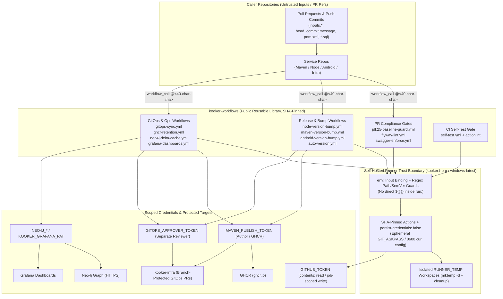
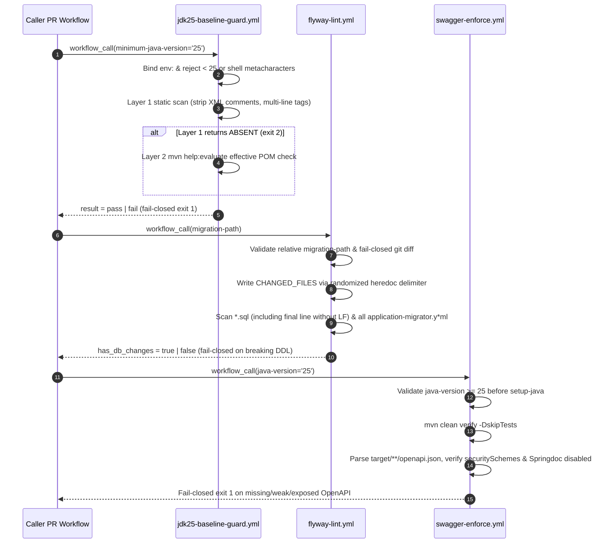
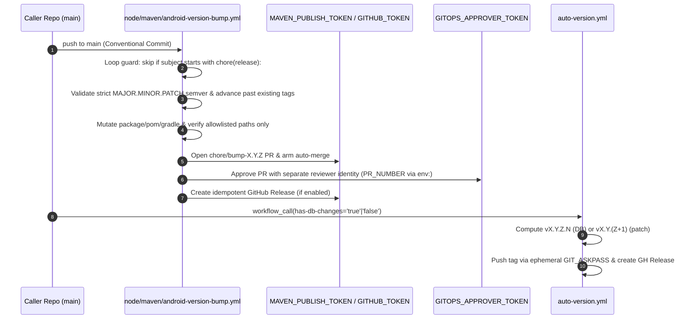
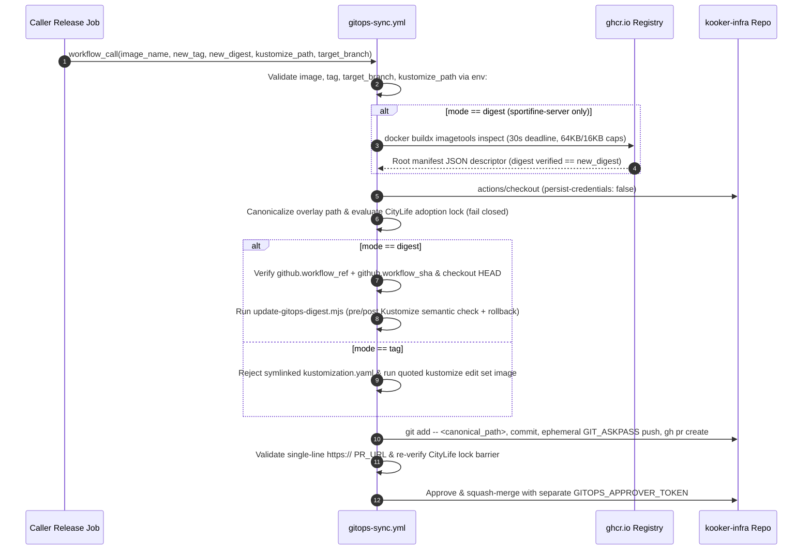
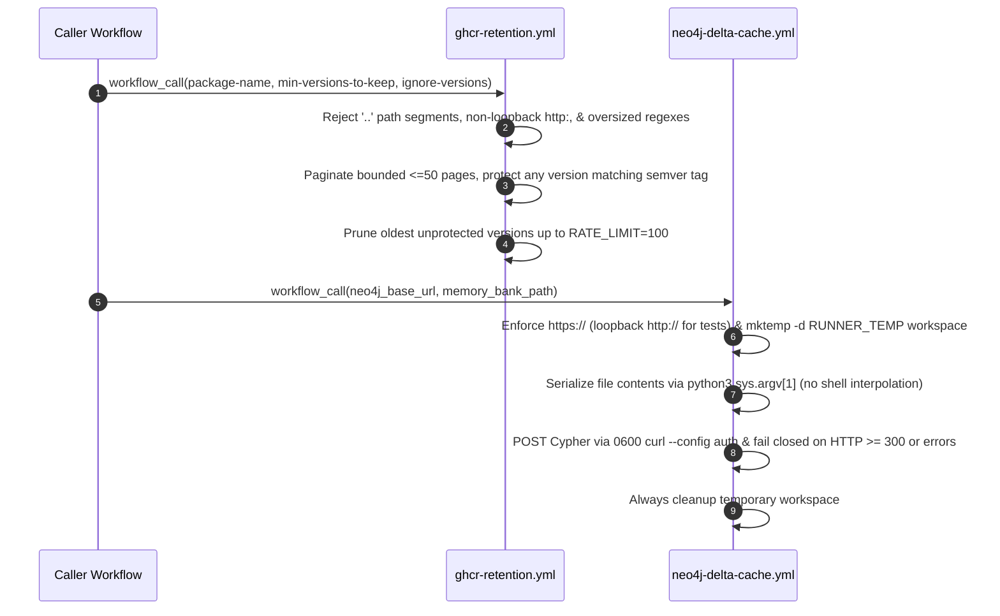

# Security Architecture — `kooker-workflows`

This document describes the trust boundaries, reusable workflow execution journeys, and security controls enforced across all 12 GitHub Actions workflows and helper scripts in `kooker-workflows`.

See also: [Documentation Index](README.md) · [Specifications Index](specs/README.md)

---

## 1. Component & Trust-Boundary Diagram

---

## 2. Auth & Security Gate Sequences

### 2.1 PR Compliance Gate Journey (`jdk25-baseline-guard` · `flyway-lint` · `swagger-enforce`)

### 2.2 Dual-Identity Version Bump & Auto-Version Journey

### 2.3 GitOps Digest-Pinned Deploy & CityLife Adoption-Lock Journey (`gitops-sync.yml`)

### 2.4 GHCR Retention & Neo4j Delta Cache Journey

---

## 3. Security Remediation Matrix (`WF-01`..`WF-15`)

| Finding ID | Severity | Service | Endpoint / Surface | File & Lines | Vulnerability Class | Impact Summary | Defensive Fix | Status | Verification Evidence |
|---|---|---|---|---|---|---|---|---|---|
| WF-01 | HIGH | kooker-workflows | `swagger-enforce.yml` (OpenAPI CI gate) | `.github/workflows/swagger-enforce.yml` | Fail-Open Validation / Unprotected Swagger Spec | Missing, empty, or malformed `openapi.json` only printed a warning and exited 0; omitted OpenAPI security scheme and Springdoc runtime exposure checks; lacked `MAVEN_PUBLISH_TOKEN` support. | Replaced warning with fail-closed Node OpenAPI 3.x/2.0 validator requiring strong `securitySchemes`, operation/global `security`, and disabled runtime Springdoc configs; added optional `MAVEN_PUBLISH_TOKEN`. | FIXED (LOCAL) | `bash tests/check-swagger-enforce.test.sh` |
| WF-02 | HIGH | kooker-workflows | `neo4j-delta-cache.yml` & `swagger-enforce.yml` (`java-version`) | `.github/workflows/neo4j-delta-cache.yml`; `.github/workflows/swagger-enforce.yml` | Arbitrary Python Execution (`CWE-94`) / JDK Baseline Drift | `neo4j-delta-cache.yml` interpolated `$fp` directly inside `python3 -c "...open('$fp')..."`; `swagger-enforce.yml` defaulted to JDK `21` without `>= 25` validation. | Passed `"$fp"` via `sys.argv[1]` (`pathlib.Path(sys.argv[1]).read_text(...)`); set `swagger-enforce.yml` default to `'25'` and rejected `< 25` or non-numeric inputs before `setup-java`. | FIXED (LOCAL) | `bash tests/check-neo4j-delta-cache.test.sh`; `bash tests/check-swagger-enforce.test.sh` |
| WF-03 | HIGH | kooker-workflows | `flyway-lint.yml` & `jdk25-baseline-guard.yml` (`inputs.*` in `run:`) | `.github/workflows/flyway-lint.yml`; `.github/workflows/jdk25-baseline-guard.yml` | CI/CD Command Injection (`CWE-78`) | Direct `${{ inputs.migration-path }}` and `${{ inputs.minimum-java-version }}` interpolation in bash `run:` blocks enabled shell injection. | Bound all `inputs.*` via step `env:`, double-quoted `"$VAR"`, and enforced relative-path / integer `>= 25` validation fail-closed. | FIXED (LOCAL) | `bash tests/check-flyway-lint.test.sh`; `node tests/check-jdk25-workflow.test.cjs` |
| WF-04 | HIGH | kooker-workflows | `jdk25-baseline-guard.yml`, `auto-version.yml`, `maven-version-bump.yml`, `neo4j-delta-cache.yml`, `node-version-bump.yml` | `.github/workflows/*.yml` | Untrusted Expression Interpolation (`CWE-78`) | Direct `${{ steps.*.outputs.* }}` interpolation inside `run:` scripts across 5 workflows. | Moved all `${{ steps.*.outputs.* }}` into step `env:` blocks referenced via `"$VAR"`; updated `check-node-merge-trigger.cjs` & `check-node-release-optout.cjs`. | FIXED (LOCAL) | `node tests/check-workflow-security.test.cjs`; `node tests/check-node-merge-trigger.cjs`; `node tests/check-node-release-optout.cjs` |
| WF-05 | HIGH | kooker-workflows | `flyway-lint.yml`, `scripts/lint-migrations.sh`, bump & cache workflows | `.github/workflows/flyway-lint.yml`; `scripts/lint-migrations.sh` | Check Bypass / `GITHUB_ENV` & `GITHUB_OUTPUT` Injection (`CWE-74`) | `while IFS= read -r line` skipped the final SQL line lacking trailing LF; static `<<EOF` enabled `GITHUB_ENV` injection; `git diff` errors were swallowed; only first `application-migrator.yml` was checked. | Added `\|\| [ -n "$line" ]`, randomized collision-checked heredoc delimiter, quoted `"$GITHUB_OUTPUT"`/`"$GITHUB_ENV"`, failed closed on missing base ref, and checked all `application-migrator.y*ml`. | FIXED (LOCAL) | `bash tests/check-flyway-lint.test.sh` |
| WF-06 | HIGH | kooker-workflows | `gitops-sync.yml`, `android-version-bump.yml`, `maven-version-bump.yml` | `.github/workflows/gitops-sync.yml`; `android-version-bump.yml`; `maven-version-bump.yml` | Unquoted Paths, Word Splitting & Flag Injection (`CWE-88`) | Unquoted `cd infra/${KUSTOMIZE_PATH}` and `kustomize edit` args; unvalidated `target_branch`; `git add .` instead of scoped overlay path; `find ... \| xargs git add`. | Quoted paths/args with `cd --`, canonicalized overlay path before `basename`, checked kustomization symlinks in `tag` mode, validated `TARGET_BRANCH` & `$PR_URL`, scoped `git add --`, used `-exec git add -- {} +`. | FIXED (LOCAL) | `node tests/check-workflow-security.test.cjs`; `bash tests/check-version-bumps.test.sh`; `node tests/check-gitops-digest-integration.cjs` |
| WF-07 | HIGH | kooker-workflows | All 12 workflows & `README.md` | `.github/workflows/*.yml`; `README.md` | Over-Privileged / Missing `permissions:` (`CWE-250`) | Seven workflows omitted `permissions:` (inheriting org default `Read and write`), and `README.md` recommended org-wide write defaults. | Added top-level `permissions: {}` and minimal job-level `permissions:` to all 12 workflows; updated `README.md` to recommend restricted org read defaults. | FIXED (LOCAL) | `node tests/check-workflow-security.test.cjs` |
| WF-08 | MEDIUM | kooker-workflows | All 12 workflows (action & ref pinning) | `.github/workflows/*.yml` | Unpinned Actions & Persisted Git Credentials (`CWE-829`) | Mutable `@v2`–`@v6` tags, omitted `persist-credentials: false`, mutable `workflows-ref: main` default, `npm ci` without `--ignore-scripts`. | Pinned all 8 GitHub Actions to 40-char commit SHAs, set `persist-credentials: false` on all checkouts with ephemeral `GIT_ASKPASS` for pushes, defaulted `workflows-ref` to `github.workflow_sha`, added `--ignore-scripts`. | FIXED (LOCAL) | `node tests/check-workflow-security.test.cjs`; `node tests/check-misc-workflows.test.cjs` |
| WF-09 | MEDIUM | kooker-workflows | `grafana-dashboards.yml` & `neo4j-delta-cache.yml` | `.github/workflows/grafana-dashboards.yml`; `.github/workflows/neo4j-delta-cache.yml` | Missing Script Fail-Open / `/tmp` Race / Argv Creds / Missing TLS | `grafana-dashboards.yml` ran missing script with `Bypass` and no `$ErrorActionPreference = 'Stop'`; `neo4j-delta-cache.yml` used `/tmp/`, `curl -u`, non-TLS URLs, and ignored HTTP status codes. | Hardened `grafana-dashboards.yml` with `shell: pwsh`, `Test-Path`, symlink refusal, and `$LASTEXITCODE`; moved Neo4j temp files to `RUNNER_TEMP` with cleanup, `0600` curl config auth, `^https://` enforcement, and HTTP status checks. | FIXED (LOCAL) | `bash tests/check-neo4j-delta-cache.test.sh`; `node tests/check-misc-workflows.test.cjs` |
| WF-10 | MEDIUM | kooker-workflows | `auto-version.yml` & `gitops-sync.yml` (`actionlint` compatibility) | `.github/workflows/auto-version.yml`; `.github/workflows/gitops-sync.yml`; `.github/actionlint.yaml` | Broken Input Contract / Linter Errors | `auto-version.yml` omitted documented `has-db-changes` input; `gitops-sync.yml` `job.workflow_*` failed `actionlint:1.7.7`; missing `.github/actionlint.yaml`. | Added `has-db-changes` input + DB micro-bump logic in `auto-version.yml`; migrated `gitops-sync.yml` D18 identity check to `github.workflow_ref` + `github.workflow_sha`; added `.github/actionlint.yaml`. | FIXED (LOCAL) | `bash tests/check-version-bumps.test.sh`; `node tests/check-gitops-digest-integration.cjs`; `actionlint:1.7.7` |
| WF-11 | MEDIUM | kooker-workflows | `scripts/check-jdk25-baseline.sh`, `android-version-bump.yml`, `maven-version-bump.yml`, `node-version-bump.yml` | `scripts/check-jdk25-baseline.sh`; `.github/workflows/*-version-bump.yml` | XML Comment/Tag Parser Bypass / Missing Strict Shell / Commit Guard | `check-jdk25-baseline.sh` matched XML comments and missed multi-line `<source>` / single-line `<jdk><version>`; bump workflows lacked `set -euo pipefail`, semver checks, double-quoted `versionName`, or Maven commit guard. | Added XML comment-stripping & multi-line/single-line XML tag parsing in `check-jdk25-baseline.sh`; enforced `set -euo pipefail`, semver validation, double-quoted `versionName` support, and Maven commit-path guard. | FIXED (LOCAL) | `bash tests/check-jdk25-baseline.test.sh`; `bash tests/check-version-bumps.test.sh` |
| WF-12 | MEDIUM | kooker-workflows | `ghcr-retention.yml` | `.github/workflows/ghcr-retention.yml` | Path-Segment Traversal (`..`), Plaintext HTTP & ReDoS (`CWE-22`, `CWE-1333`) | `encodeURIComponent('..')` kept `..`; non-loopback `http:` allowed; unbounded `ignore-versions` regex. | Rejected `.`/`..` owner/package segments, restricted `http:` strictly to loopback test hosts, and capped regex length at 256 characters. | FIXED (LOCAL) | `node tests/check-ghcr-retention.test.cjs` (33/33) |
| WF-13 | MEDIUM | kooker-workflows | Public safety & `.gitattributes` / CLI arg parsing | `.github/workflows/neo4j-delta-cache.yml`; `.github/copilot_instructions.md`; `README.md`; `docs/jdk25-baseline-adoption.md`; `tests/*`; `.gitattributes`; `scripts/*.sh` | Public Safety Violations / CRLF Breakage / CLI Parsing | Exposed private home-directory path, default observability credentials, personal-name memory-bank identifiers, internal codenames, and Windows CRLF line endings; `$2` unchecked in CLI parsers. | Parameterized memory-bank inputs, removed private paths/creds/personal names/codenames, added `.gitattributes` (`eol=lf`), and added `$# -lt 2` CLI guards. | FIXED (LOCAL) | `node tests/check-workflow-security.test.cjs`; Docker `zricethezav/gitleaks:latest` |
| WF-14 | MEDIUM | kooker-workflows | `tests/*` & `.github/workflows/self-test.yml` | `tests/*.test.sh`; `tests/*.cjs`; `.github/workflows/self-test.yml` | Insufficient CI Coverage (7/12 Workflows Untested) | Only 5 workflows had tests; `self-test.yml` skipped `actionlint` and omitted 7 workflows and `lint-migrations.sh`. | Added 7 new test suites covering 100% of all 12 workflows and 5 scripts; wired every suite + `actionlint` into `self-test.yml`. | FIXED (LOCAL) | `node tests/check-misc-workflows.test.cjs`; all `tests/*.test.sh` & `tests/*.cjs` |
| WF-15 | LOW | kooker-workflows | `README.md`, `docs/`, `docs/specs/` | `README.md`; `docs/README.md`; `docs/specs/*`; `docs/security-architecture.md` | Stale Documentation & Missing Specs / Mermaid UMLs | 4 workflows undocumented in `README.md`; stale contracts; missing `docs/README.md`, numbered specs, and Mermaid UML diagrams. | Documented all 12 workflows in `README.md`, created `docs/README.md`, `docs/specs/001`–`003`, and `docs/security-architecture.md` with Mermaid UML diagrams. | FIXED (LOCAL) | Repository inspection & `node tests/check-workflow-security.test.cjs` |
